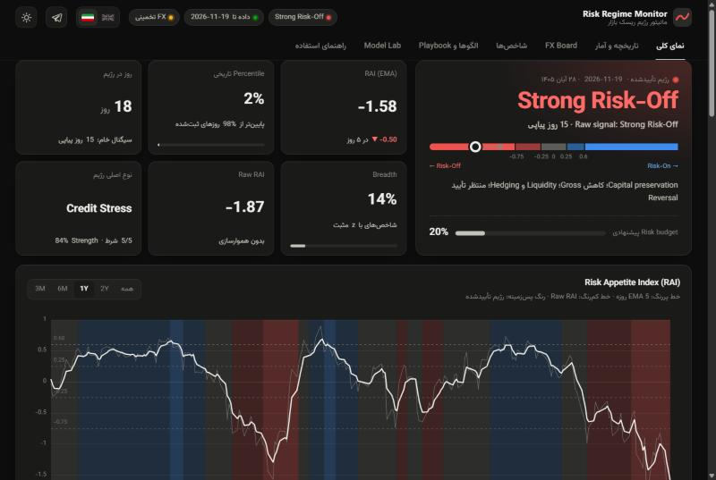

<div dir="rtl">

# Risk Regime Monitor

[English](README.md) · **فارسی**

مانیتور روزانه‌ی رژیم Risk-On / Risk-Off برای معامله‌گرهای FX. این ابزار ۱۴ شاخص بازار را در یک عدد به اسم
**Risk Appetite Index (RAI)** ترکیب می‌کند، رژیم بازار را از Strong Risk-On تا Strong Risk-Off تعیین می‌کند،
می‌گوید Risk-On یا Risk-Off از **چه نوعی** است (۱۱ Regime type) و آن را به یک Playbook برای FX وصل می‌کند.
سایت هر روز کاری خودکار به‌روز می‌شود و به دو زبان فارسی و انگلیسی در دسترس است.

**داشبورد زنده: https://sinafxd.github.io/RiskRegimeMonitor/**



## بخش‌های سایت

| بخش | به چه سؤالی جواب می‌دهد |
|---|---|
| **نمای کلی** | رژیم تأییدشده‌ی امروز، جایگاه RAI روی مقیاس رژیم، Risk budget پیشنهادی، Regime type و ۵ شرطش، هشدارها و Score پنج Category |
| **تاریخچه و آمار** | RAI در کنار S&P 500 و ارزها، همه‌ی دوره‌های رژیم و بازده ۲۰ روزه‌ی بعد از هر رژیم؛ با دانلود CSV |
| **FX Board** | عملکرد ۱۵ ارز در برابر USD و اینکه هر ارز طبق انتظار رژیم رفتار می‌کند یا نه |
| **شاخص‌ها** | برای هر شاخص یک کارت: Signed z، نمودار ۶ ماهه، آخرین مقدار و تازگی داده |
| **الگوها و Playbook** | ۱۱ Regime type با شرط‌ها، Long، Short، Hedge و Invalidation |
| **Model Lab** | تغییر وزن‌ها، Smoothing و آستانه‌ها و اجرای دوباره‌ی مدل در مرورگر |
| **راهنمای استفاده** | راهنمای ساده، روتین ۲ دقیقه‌ای، سؤال‌های رایج، واژه‌نامه و جزئیات فنی |

## مدل چطور کار می‌کند

<div dir="ltr">

```
FRED + ECB data ─► transform ─► rolling z-score (252d, capped ±3, signed) ─► 5 category scores
   ─► RAI (weighted mean) ─► 5-day EMA ─► regime label ─► confirmed after 3 days in a row
   ─► regime type (11 patterns × 5 conditions) ─► playbook, alerts, FX Board
```

</div>

1. **Transform:** هر سری به یکی از این‌ها تبدیل می‌شود: خود سطح (LEVEL)، Log return بیست روزه (RET)، Drawdown از
   سقف ۲۵۲ روزه (DD) یا میانگین ۱۰ روزه‌ی Spread (CP10).
2. **نرمال‌سازی:** z = (x − میانگین ۲۵۲ روزه) ÷ انحراف معیار ۲۵۲ روزه، محدود به ±3 و ضرب‌شده در جهت شاخص؛ پس
   عدد مثبت همیشه یعنی «خوب برای ریسک».
3. **تجمیع:** Score هر Category میانگین Signed z شاخص‌های در دسترس آن است. RAI میانگین وزنی Categoryهاست و اگر
   داده‌ای نباشد، وزن‌ها دوباره نرمال می‌شوند.
4. **برچسب:** EMA پنج روزه‌ی RAI با آستانه‌های ثابت مقایسه می‌شود. رژیم فقط وقتی عوض می‌شود که برچسب جدید ۳ روز
   پشت سر هم تکرار شود (Confirmation).
5. **توضیح:** ۱۱ Regime type هر کدام با ۵ شرط سنجیده می‌شوند (z-score تغییرات ۲۰ روزه‌ی Yieldها، Breakeven،
   Real yield، نفت، USDJPY و USD، به‌علاوه‌ی Score Categoryها و Correlationها). نوع اصلی از میان الگوهای
   هم‌خانواده با رژیم فعلی انتخاب می‌شود.

### شاخص‌ها

| Category (وزن) | شاخص | Transform | افزایش یعنی |
|---|---|---|---|
| Volatility (20%) | VIX | Level | Risk-Off |
| | VIX / VIX3M (Term structure) | Level | Risk-Off |
| | VXEEM (EM equity implied vol) | Level | Risk-Off |
| | UST 10Y realized vol (Proxy برای MOVE) | Realized vol بیست روزه‌ی تغییرات روزانه‌ی بازده ۱۰ ساله، bp سالانه | Risk-Off |
| Credit (20%) | US High Yield OAS | Level | Risk-Off |
| | US Investment Grade OAS | Level | Risk-Off |
| | EM Corporate OAS | Level | Risk-Off |
| FX (25%) | AUDJPY | بازده ۲۰ روزه | Risk-On |
| | EM FX basket (MXN, BRL, ZAR, KRW) | بازده ۲۰ روزه | Risk-On |
| | EURCHF | بازده ۲۰ روزه | Risk-On |
| Equities & Growth (20%) | S&P 500 momentum | بازده ۲۰ روزه | Risk-On |
| | S&P 500 drawdown | فاصله از سقف ۲۵۲ روزه | Risk-On |
| Funding & USD (15%) | USD Broad index | بازده ۲۰ روزه | Risk-Off |
| | CP – T-bill spread | میانگین ۱۰ روزه، bp | Risk-Off |

### رژیم‌ها

| رژیم | EMA پنج روزه‌ی RAI | Risk budget پیشنهادی |
|---|---|---|
| Strong Risk-On | ≥ 0.60 | 100% |
| Risk-On | 0.25 تا 0.60 | 75% |
| Neutral | −0.25 تا 0.25 | 50% |
| Risk-Off | −0.75 تا −0.25 | 35% |
| Strong Risk-Off | ≤ −0.75 | 20% |

### Regime typeها

| خانواده | نوع | نشانه‌ها |
|---|---|---|
| Risk-Off | Growth Scare | بازده 10Y و 2Y پایین می‌آید، Breakeven و نفت افت می‌کنند و JPY قوی می‌شود |
| Risk-Off | Inflation Shock | نفت، Breakeven و Nominal yieldها بالا می‌روند؛ JPY ضعیف می‌شود و Treasuries دیگر Hedge سهام نیستند |
| Risk-Off | Real-Rate / Hawkish Shock | Real yield و بازده 2Y بالا می‌روند ولی Breakeven نه؛ USD قوی، JPY ضعیف |
| Risk-Off | USD Funding Squeeze | USD در برابر همه جهش می‌کند، CP spread باز می‌شود و EM و Credit همزمان زیر فشارند |
| Risk-Off | Carry Unwind | JPY جهش می‌کند، AUDJPY و EM FX سقوط می‌کنند، Volatility بالا می‌رود و CHF قوی می‌شود |
| Risk-Off | Sell-America | سهام، Treasuries و USD آمریکا با هم افت می‌کنند و Safe havenهای غیرآمریکایی قوی می‌شوند |
| Risk-Off | Credit Stress | Spreadهای HY، IG و EM باز می‌شوند، Credit هم‌اندازه یا بدتر از Volatility ضعیف است و Correlation بالاست |
| Risk-On | Goldilocks | Volatility پایین، Rates و تورم آرام، Credit قوی و سهام رو به بالا |
| Risk-On | Reflation | Yieldها، Breakeven و نفت همراه با سهام بالا می‌روند |
| Risk-On | Weak-USD Liquidity | USD ضعیف، EM FX قوی و شرایط Credit و Funding آسان |
| Risk-On | Carry-Friendly | Volatility خیلی پایین، JPY ضعیف، AUDJPY و EM قوی و Credit محکم |

### Guardrail

z-score نسبت به ۲۵۲ روز گذشته سنجیده می‌شود، پس در یک بحران طولانی استرس کم‌کم «عادی» به نظر می‌رسد. برای
همین یک Guardrail مطلق کنار مدل کار می‌کند: اگر **VIX ≥ 30** یا **HY OAS ≥ 5%** شود، Alert فعال می‌شود و یک
کادر در نمای کلی ظاهر می‌شود. اگر همزمان رژیم Neutral یا بهتر باشد، کادر قرمز می‌شود. Guardrail خود رژیم را
تغییر نمی‌دهد.

### هشدارها

جدا از Guardrail، نمای کلی این موارد را هم بررسی می‌کند: معکوس شدن VIX term structure، تأیید نشدن رالی Equities
توسط Credit، هشدار زودتر FX نسبت به Equities، USD funding stress، Breadth divergence، Safe haven نبودن JPY،
Correlation spike، منفی شدن Stock–bond correlation، وخامت سریع، احتمال Bottoming، داده‌ی قدیمی و پوشش ناقص
Categoryها.

## داده و به‌روزرسانی

- **منابع:** [FRED](https://fred.stlouisfed.org/) (شاخص‌های Volatility از CBOE، OAS از ICE BofA، S&P 500،
  Treasury yieldها، Breakeven، WTI، Commercial paper، نرخ ارزهای H.10 و Broad dollar index) و
  [ECB reference rates](https://data.ecb.europa.eu/).
- **پر کردن جای خالی FX:** FRED نرخ ارزهای H.10 را هفتگی منتشر می‌کند. برای روزهای بعد از آخرین عدد FRED،
  تغییرات روزانه‌ی ECB روی آخرین عدد FRED زنجیر می‌شود (در سایت با برچسب «ECB»). با انتشار بعدی FRED عدد رسمی
  جایگزین می‌شود.
- **حقوق داده:** داده‌ی خام در این repository ذخیره نمی‌شود. Spreadهای ICE BofA طبق شرایط FRED فقط به‌صورت z-score
  نمایش داده می‌شوند. FRED فقط ۳ سال اخیر ICE BofA را منتشر می‌کند، پس Category Credit از حدود نوامبر 2024 z دارد.
- **زمان‌بندی:** GitHub Actions ([`update.yml`](.github/workflows/update.yml)) هر روز کاری ساعت 22:30 و 14:00 UTC
  (حدود ۰۲:۰۰ و ۱۷:۳۰ تهران) داده را می‌گیرد، مدل را اجرا می‌کند، `site/data/latest.json` را commit می‌کند و
  `site/` را روی GitHub Pages منتشر می‌کند.

## اجرای محلی

نیاز به Python 3.10 یا بالاتر.

<div dir="ltr">

```bash
pip install -r requirements.txt
python fetch_fred.py        # downloads FRED + ECB data into data/
python export_site.py       # runs the model and writes site/data/latest.json
python -m http.server 8765 --directory site
```

</div>

سپس http://localhost:8765 را باز کنید.

## ساختار پروژه

| مسیر | کار |
|---|---|
| [`spec.py`](spec.py) | منبع واحد تعریف‌ها: سری‌های داده، شاخص‌ها، Categoryها، وزن‌ها، رژیم‌ها و پارامترها |
| [`reference2.py`](reference2.py) | خود مدل با pandas: Transformها، z-score، Categoryها، RAI، رژیم و امتیاز Regime typeها |
| [`playbook.py`](playbook.py) | ۱۱ Regime type (شرط‌ها و متن Playbook) و ارزهای FX Board |
| [`export_site.py`](export_site.py) | اجرای مدل و خروجی همه‌ی چیزهایی که سایت نشان می‌دهد در `site/data/latest.json` |
| [`fetch_fred.py`](fetch_fred.py)، [`fetch_ecb.py`](fetch_ecb.py) | دریافت داده |
| [`site/`](site) | وب‌سایت استاتیک: `index.html`، `assets/app.js`، `assets/style.css` (ECharts، بدون Build step) |

## محدودیت‌ها

- z-score نسبی است: بعد از یک سال خیلی آرام، یک حرکت معمولی هم «استرس» دیده می‌شود و در یک بحران طولانی استرس
  کم‌کم به صفر نزدیک می‌شود. Guardrail بخشی از این ضعف را پوشش می‌دهد.
- Proxy برای MOVE از نوع Realized است نه Implied، پس کمی دیرتر از خود MOVE واکنش نشان می‌دهد.
- داده‌ها پایان روز هستند؛ داشبورد رژیم بازار را نشان می‌دهد، نه Entry point.

## سلب مسئولیت

این ابزار آموزشی و تحلیلی است و توصیه‌ی سرمایه‌گذاری نیست.

## سازنده

ساخته‌ی **SinaFXD**: [Telegram @SinaFXD](https://t.me/SinaFXD) · [GitHub @SinaFXD](https://github.com/SinaFXD)

</div>
