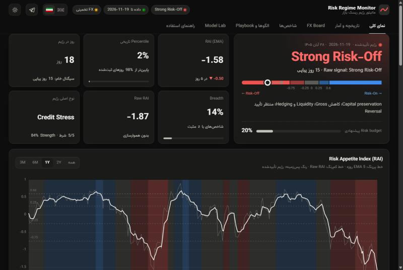

# Risk Regime Monitor

[](https://github.com/SinaFXD/RiskRegimeMonitor/actions/workflows/update.yml)
[](https://sinafxd.github.io/RiskRegimeMonitor/)

**English** · [فارسی](README.fa.md)

A daily Risk-On / Risk-Off regime monitor for FX traders. It combines 14 cross-asset market indicators
into a single **Risk Appetite Index (RAI)**, labels the market regime from Strong Risk-On to Strong Risk-Off,
works out *what kind* of Risk-On or Risk-Off it is (11 regime types) and maps it to an FX playbook.
The site updates itself every business day and is available in Persian and English.

**Live dashboard: https://sinafxd.github.io/RiskRegimeMonitor/**



## What the dashboard shows

| Section | What it answers |
|---|---|
| **Overview** | Today's confirmed regime, RAI on the regime scale, suggested risk budget, the regime type and its 5 conditions, alerts and the 5 category scores |
| **History & stats** | RAI next to the S&P 500 and FX, every regime episode, and forward 20-day returns after each regime; CSV download |
| **FX Board** | 15 currencies vs USD over several horizons, and whether each one behaves as the regime predicts |
| **Indicators** | One card per indicator: signed z-score, 6-month sparkline, latest value and data freshness |
| **Types & Playbook** | The 11 regime types with their conditions, longs, shorts, hedges and invalidation |
| **Model Lab** | Change weights, smoothing and thresholds and re-run the model in the browser |
| **User guide** | A plain-language guide, a 2-minute daily routine, FAQ, glossary and technical details |

## How the model works

```
FRED + ECB data ─► transform ─► rolling z-score (252d, capped ±3, signed) ─► 5 category scores
   ─► RAI (weighted mean) ─► 5-day EMA ─► regime label ─► confirmed (2 days down, 3 days up)
   ─► regime type (11 patterns × 5 conditions) ─► playbook, alerts, FX Board
```

1. **Transform.** Each series becomes a level, a 20-day log return (RET), a drawdown from its 252-day high (DD)
   or a 10-day average spread (CP10).
2. **Normalise.** z = (x − 252-day mean) ÷ 252-day std dev, capped at ±3 and multiplied by the indicator's
   direction, so a positive number always means "good for risk".
3. **Aggregate.** Each category score is the mean signed z of its available indicators. The RAI is the weighted mean
   of the categories; weights are re-normalised when data is missing.
4. **Label.** The 5-day EMA of the RAI is compared with fixed thresholds. Confirmation is directional: 2 consecutive
   days below the current regime move it down (to the mildest of those labels), 3 consecutive days above move it up.
5. **Explain.** 11 regime types are scored on 5 conditions each (z-scores of 20-day changes in yields, breakevens,
   real yields, oil, USDJPY and USD, plus category scores and correlations). The primary type is chosen within
   the current regime's family.

### Indicators

| Category (weight) | Indicator | Transform | A rise means |
|---|---|---|---|
| Volatility (20%) | VIX | Level | Risk-Off |
| | VIX / VIX3M (term structure) | Level | Risk-Off |
| | VXEEM (EM equity implied vol) | Level | Risk-Off |
| | UST 10Y realized vol (MOVE proxy) | 20-day realized vol of daily 10Y yield changes, bp/yr | Risk-Off |
| Credit (20%) | US High Yield OAS | Level | Risk-Off |
| | US Investment Grade OAS | Level | Risk-Off |
| | EM Corporate OAS | Level | Risk-Off |
| FX (25%) | AUDJPY | 20-day return | Risk-On |
| | EM FX basket (MXN, BRL, ZAR, KRW) | 20-day return | Risk-On |
| | EURCHF | 20-day return | Risk-On |
| Equities & Growth (20%) | S&P 500 momentum | 20-day return | Risk-On |
| | S&P 500 drawdown | Distance from 252-day high | Risk-On |
| Funding & USD (15%) | USD Broad index | 20-day return | Risk-Off |
| | CP – T-bill spread | 10-day average, bp | Risk-Off |

### Regimes

| Regime | EMA of RAI | Suggested risk budget |
|---|---|---|
| Strong Risk-On | ≥ 0.60 | 100% |
| Risk-On | 0.25 to 0.60 | 75% |
| Neutral | −0.25 to 0.25 | 50% |
| Risk-Off | −0.75 to −0.25 | 35% |
| Strong Risk-Off | ≤ −0.75 | 20% |

### Regime types

| Family | Type | Signature |
|---|---|---|
| Risk-Off | Growth Scare | 10Y and 2Y yields fall, breakevens and oil drop, JPY strengthens |
| Risk-Off | Inflation Shock | Oil, breakevens and nominal yields rise; JPY weakens; Treasuries stop hedging equities |
| Risk-Off | Real-Rate / Hawkish Shock | Real and 2Y yields rise but breakevens do not; USD strong, JPY weak |
| Risk-Off | USD Funding Squeeze | USD jumps against everything, CP spread widens, EM and Credit under pressure |
| Risk-Off | Carry Unwind | JPY spikes, AUDJPY and EM FX slump, volatility rises, CHF strengthens |
| Risk-Off | Sell-America | US equities, Treasuries and USD fall together; non-US safe havens strengthen |
| Risk-Off | Credit Stress | HY, IG and EM spreads widen; Credit as weak as volatility or worse; high correlation |
| Risk-On | Goldilocks | Low volatility, calm rates and inflation, strong Credit, rising equities |
| Risk-On | Reflation | Yields, breakevens and oil up together with equities |
| Risk-On | Weak-USD Liquidity | Weak USD, strong EM FX, easy credit and funding |
| Risk-On | Carry-Friendly | Very low volatility, weak JPY, strong AUDJPY and EM, firm Credit |

### Guardrail

z-scores are relative to the last 252 days, so a long crisis slowly starts to look "normal". An absolute-level
guardrail runs alongside the model: when **VIX ≥ 30** or **HY OAS ≥ 5%** it raises alerts and shows a banner on
the overview. The banner turns red when the regime is still Neutral or better. The guardrail never changes the
regime itself.

### Alerts

Besides the guardrail, the overview checks for an inverted VIX term structure, Credit not confirming an equity
rally, FX warning ahead of equities, USD funding stress, breadth divergence, JPY not acting as a safe haven,
correlation spikes, a positive stock–bond correlation, rapid deterioration, possible bottoming, stale data and
incomplete category coverage.

## Data and updates

- **Sources:** [FRED](https://fred.stlouisfed.org/) (CBOE volatility indices, ICE BofA OAS, S&P 500, Treasury yields,
  breakevens, WTI, commercial paper, Fed H.10 exchange rates and the broad dollar index) and
  [ECB reference rates](https://data.ecb.europa.eu/).
- **FX gap-fill:** FRED publishes H.10 exchange rates weekly. For the days after FRED's latest observation, daily ECB
  changes are chained onto FRED's last value (marked "ECB" on the site); FRED's official values replace them on
  the next release.
- **Licensing:** raw data is not committed to this repository. ICE BofA spreads are shown only as z-scores, in line
  with FRED's terms for that data. FRED serves only the last 3 years of ICE BofA history, so the Credit category
  has z-scores from about November 2024.
- **Schedule:** GitHub Actions ([`update.yml`](.github/workflows/update.yml)) runs on weekdays at 22:30 and 14:00 UTC,
  downloads the data, runs the model, commits `site/data/latest.json` and deploys `site/` to GitHub Pages.

## Run it locally

Requires Python 3.10+.

```bash
pip install -r requirements.txt
python fetch_fred.py        # downloads FRED + ECB data into data/
python export_site.py       # runs the model and writes site/data/latest.json
python -m http.server 8765 --directory site
```

Then open http://localhost:8765.

## Project structure

| Path | Purpose |
|---|---|
| [`spec.py`](spec.py) | Single source of truth: data series, indicators, categories, weights, regimes and parameters |
| [`reference2.py`](reference2.py) | The model in pandas: transforms, z-scores, categories, RAI, regime and type scores |
| [`playbook.py`](playbook.py) | The 11 regime types (conditions and playbook text) and the FX Board universe |
| [`export_site.py`](export_site.py) | Runs the model and exports everything the site shows to `site/data/latest.json` |
| [`fetch_fred.py`](fetch_fred.py), [`fetch_ecb.py`](fetch_ecb.py) | Data download |
| [`site/`](site) | The static website: `index.html`, `assets/app.js`, `assets/style.css` (ECharts, no build step) |

## Limitations

- The z-score is relative: after a very calm year an ordinary move can register as stress, and during a long
  crisis stress slowly fades toward zero. The guardrail covers part of this.
- The MOVE proxy is realized, not implied, volatility, so it reacts a little later than MOVE itself.
- Data is end-of-day; the dashboard shows the regime, not entry points.

## Disclaimer

This is an educational and analytical tool. It is not investment advice.

## Author

Built by **SinaFXD**: [Telegram @SinaFXD](https://t.me/SinaFXD) · [GitHub @SinaFXD](https://github.com/SinaFXD)
